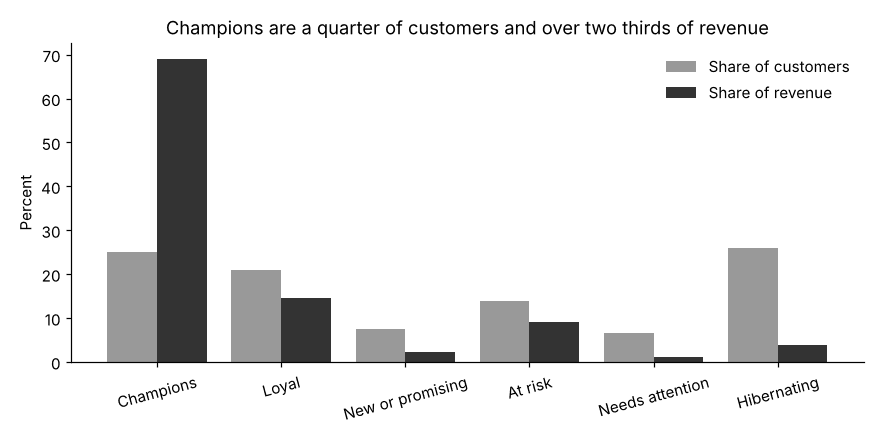

# Customer segmentation (RFM) for an online retailer

**Question.** Which customers drive the revenue of a UK online gift wholesaler, which ones are slipping away, and what is it worth to act?

**Answer in one line.** A quarter of customers (the Champions) bring 69% of revenue, and a group of 824 once valuable customers is drifting away: they spent £1.33 million in the first year and only £0.31 million in the second. Winning back 15% of them (an assumption) is worth about £199,000 a year.

## Approach

* Loaded 1,067,371 transaction lines (December 2009 to December 2011) from the UCI Online Retail II dataset into SQLite.
* Cleaned in SQL: removed cancellations, zero or negative lines and lines with no customer (24.5% of rows).
* Scored every customer 1 to 5 on Recency, Frequency and Monetary value with the NTILE window function, then grouped them into six segments with a CASE rule.
* Compared each segment's spend in year one and year two to find who is fading, and sized two actions.

## Key findings

| Segment | Customers | Share of customers | Revenue (£) | Share of revenue | Avg orders | Avg spend (£) |
|---|---|---|---|---|---|---|
| Champions | 1,473 | 25.1% | 12,254,731 | 69.1% | 15.7 | 8,320 |
| Loyal | 1,229 | 20.9% | 2,586,345 | 14.6% | 5.5 | 2,104 |
| New or promising | 440 | 7.5% | 394,038 | 2.2% | 1.5 | 896 |
| At risk | 824 | 14.0% | 1,634,077 | 9.2% | 4.9 | 1,983 |
| Needs attention | 384 | 6.5% | 204,693 | 1.2% | 1.4 | 533 |
| Hibernating | 1,528 | 26.0% | 669,546 | 3.8% | 1.3 | 438 |

* **Revenue is concentrated.** The top 10% of customers bring 63.9% of revenue and the top 1% bring 31.8%. 72.4% of customers have ordered more than once, so this is a repeat business.
* **The At risk group is a leak.** These 824 customers ordered 4.9 times on average but have not bought for about a year (369 days on average). Their spend fell from £1,326,233 in the first year to £307,843 in the second.
* **Sales are seasonal and UK heavy.** Revenue peaks every September to November (over £1.1 million in November in both years), and the UK brings 83.0% of revenue. 6.2% of gross sales value was later cancelled.



## SQL highlights

Three of the nine queries in `analysis.sql`, with the result each one returns. All results are real outputs from `run.py` on the UCI Online Retail II data.

### RFM scoring with NTILE window functions

```sql
-- 03 customer rfm
-- Recency = days from last order to 10 Dec 2011 (day after the data ends).
-- Frequency = number of orders. Monetary = total spend.
-- Each is scored 1 to 5 with NTILE, 5 being best.
WITH clean AS (
  SELECT * FROM transactions
  WHERE invoice NOT LIKE 'C%' AND customer IS NOT NULL AND quantity > 0 AND price > 0
),
base AS (
  SELECT customer,
         CAST(JULIANDAY('2011-12-10') - JULIANDAY(MAX(invoicedate)) AS INT) AS recency,
         COUNT(DISTINCT invoice) AS frequency,
         SUM(quantity * price) AS monetary
  FROM clean GROUP BY customer
)
SELECT CAST(customer AS INT) AS "customer",
       recency AS "recency days", frequency AS "orders", ROUND(monetary, 2) AS "spend gbp",
       NTILE(5) OVER (ORDER BY recency DESC) AS "r score",
       NTILE(5) OVER (ORDER BY frequency) AS "f score",
       NTILE(5) OVER (ORDER BY monetary) AS "m score"
FROM base;
```

Result, top 5 customers by spend (the full per customer file is created by `run.py` and kept out of the repo):

| Customer | Recency days | Orders | Spend (GBP) | R score | F score | M score |
|---|---|---|---|---|---|---|
| 18102 | 0 | 145 | 608,822 | 5 | 5 | 5 |
| 14646 | 1 | 151 | 528,603 | 5 | 5 | 5 |
| 14156 | 9 | 156 | 313,946 | 5 | 5 | 5 |
| 14911 | 1 | 398 | 295,973 | 5 | 5 | 5 |
| 17450 | 8 | 51 | 246,973 | 5 | 5 | 5 |

### Segments from the scores

```sql
-- 04 segments
WITH clean AS (
  SELECT * FROM transactions
  WHERE invoice NOT LIKE 'C%' AND customer IS NOT NULL AND quantity > 0 AND price > 0
),
base AS (
  SELECT customer,
         JULIANDAY('2011-12-10') - JULIANDAY(MAX(invoicedate)) AS recency,
         COUNT(DISTINCT invoice) AS frequency,
         SUM(quantity * price) AS monetary
  FROM clean GROUP BY customer
),
scored AS (
  SELECT *, NTILE(5) OVER (ORDER BY recency DESC) AS r, NTILE(5) OVER (ORDER BY frequency) AS f
  FROM base
),
seg AS (
  SELECT *,
    CASE
      WHEN r >= 4 AND f >= 4 THEN '1 Champions'
      WHEN r >= 3 AND f >= 3 THEN '2 Loyal'
      WHEN r >= 4 AND f <= 2 THEN '3 New or promising'
      WHEN r <= 2 AND f >= 3 THEN '4 At risk'
      WHEN r <= 2 AND f <= 2 THEN '6 Hibernating'
      ELSE '5 Needs attention' END AS segment
  FROM scored
)
SELECT segment AS "segment",
       COUNT(*) AS "customers",
       ROUND(100.0 * COUNT(*) / SUM(COUNT(*)) OVER (), 1) AS "share of customers pct",
       ROUND(SUM(monetary), 0) AS "revenue gbp",
       ROUND(100.0 * SUM(monetary) / SUM(SUM(monetary)) OVER (), 1) AS "share of revenue pct",
       ROUND(AVG(recency), 0) AS "avg recency days",
       ROUND(AVG(frequency), 1) AS "avg orders",
       ROUND(AVG(monetary), 0) AS "avg spend gbp"
FROM seg GROUP BY segment ORDER BY segment;
```

Result (`output/04 segments.csv`):

| Segment | Customers | Share of customers % | Revenue (GBP) | Share of revenue % | Avg recency days | Avg orders | Avg spend (GBP) |
|---|---|---|---|---|---|---|---|
| 1 Champions | 1,473 | 25.1 | 12,254,731 | 69.1 | 20 | 15.7 | 8,320 |
| 2 Loyal | 1,229 | 20.9 | 2,586,345 | 14.6 | 78 | 5.5 | 2,104 |
| 3 New or promising | 440 | 7.5 | 394,038 | 2.2 | 28 | 1.5 | 896 |
| 4 At risk | 824 | 14 | 1,634,077 | 9.2 | 369 | 4.9 | 1,983 |
| 5 Needs attention | 384 | 6.5 | 204,693 | 1.2 | 106 | 1.4 | 533 |
| 6 Hibernating | 1,528 | 26 | 669,546 | 3.8 | 458 | 1.3 | 438 |

Champions are a quarter of customers and 69% of revenue; at risk customers still hold 9% of revenue.

### Repeat rate and revenue concentration

```sql
-- 05 repeat and concentration
WITH clean AS (
  SELECT * FROM transactions
  WHERE invoice NOT LIKE 'C%' AND customer IS NOT NULL AND quantity > 0 AND price > 0
),
c AS (SELECT customer, COUNT(DISTINCT invoice) AS n, SUM(quantity * price) AS spend FROM clean GROUP BY customer),
ranked AS (SELECT *, ROW_NUMBER() OVER (ORDER BY spend DESC) AS rk, COUNT(*) OVER () AS total, SUM(spend) OVER () AS rev FROM c)
SELECT COUNT(*) AS "customers",
       ROUND(100.0 * AVG(n >= 2), 1) AS "repeat customer pct",
       ROUND(100.0 * SUM(CASE WHEN rk <= total * 0.10 THEN spend END) / MAX(rev), 1) AS "top 10 pct of customers share of revenue",
       ROUND(100.0 * SUM(CASE WHEN rk <= total * 0.01 THEN spend END) / MAX(rev), 1) AS "top 1 pct of customers share of revenue"
FROM ranked;
```

Result (`output/05 repeat and concentration.csv`):

| Customers | Repeat customer % | Top 10 % of customers share of revenue | Top 1 % of customers share of revenue |
|---|---|---|---|
| 5,878 | 72.4 | 63.9 | 31.8 |

## Recommendations

| # | Action | Sizing | Annual revenue impact |
|---|---|---|---|
| 1 | **Win back At risk customers** with a personal account call and a reorder offer timed before the autumn peak | 824 customers x 15% return to their year one spend of £1,610 (**assumption**) | about £199,000 |
| 2 | **Protect Champions** with a named account manager and early access to the autumn range | 1,473 customers x 5% fewer lapses (**assumption**) x £4,294 average spend in the last year | about £316,000 |

Both uplift rates are assumptions kept in one place in `run.py`; every other input comes from the queries.

## Files

```
CustomerSegmentationRFM/
  README.md          this summary
  Build Guide.md     step by step instructions
  load.py            loads the workbook into retail.db
  analysis.sql       all queries, commented
  run.py             runs the queries, sizes the actions, draws the chart
  output/            one CSV per query (the customer level RFM table is created when you run it)
  charts/            chart used above
  data/              put the UCI workbook here (not committed)
```

## Tools

SQL (SQLite: CTEs, NTILE, ROW NUMBER and SUM OVER window functions, CASE segmentation), Python (pandas, matplotlib) to load, run and chart.

## How to run

1. Download the dataset from the [UCI Machine Learning Repository: Online Retail II](https://archive.ics.uci.edu/dataset/502/online+retail+ii), unzip it and save the workbook in `data/` as `online retail.xlsx`.
2. Run:

```
pip install pandas openpyxl matplotlib
python load.py
python run.py
```

Data: Chen, D. (2012). Online Retail II. UCI Machine Learning Repository. CC BY 4.0.
